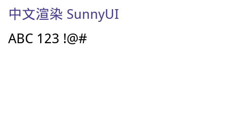
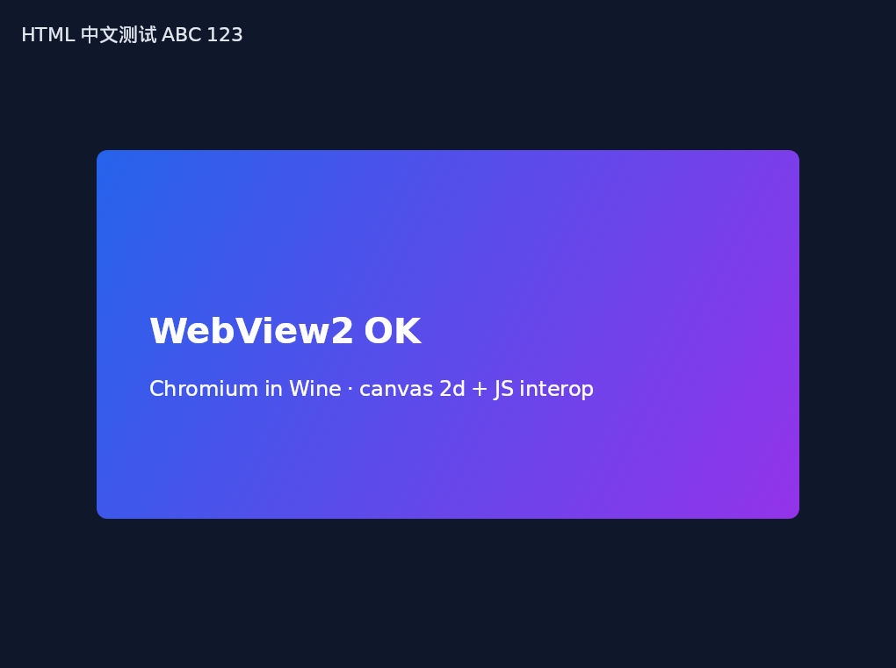

# winforms-wine-runtime

[](https://github.com/webees/winforms-wine-runtime/actions/workflows/ci.yml)
[](https://github.com/webees/winforms-wine-runtime/releases)
[](https://github.com/webees/winforms-wine-runtime/pkgs/container/winforms-wine-runtime)
[](LICENSE)

Run **.NET 8 WinForms** desktop applications — including **WebView2**, **SunnyUI** and
**Magick.NET** — inside a Linux container, and reach them from any browser.

The image is a thin, verified runtime: Wine 10, Xvfb, the WebView2 Fixed Version
runtime, CJK font substitution, and the MSVC runtime Chromium needs. Your
application is copied in as a self-contained `win-x64` publish output.

```
browser ── noVNC :6080 ──► x11vnc ──► Xvfb :99 ──► Wine 10 ──► YourApp.exe
                                                          ├─ .NET 8 (self-contained)
                                                          ├─ WebView2 Fixed Version 135
                                                          ├─ SunnyUI
                                                          └─ Magick.NET
```

## Why

- **Cost** — 300–500 MB per session instead of 4–8 GB for a Windows VM.
- **Licensing** — Wine needs no Windows licence; Windows client editions do not
  permit multi-session hosting anyway.
- **Deployment** — the same `docker run` / Kubernetes primitives you already use.

## Quick start

```bash
make build-demo
docker run --rm -p 6080:6080 \
  -e ENABLE_VNC=1 -e VNC_PASSWORD=change-me \
  -v wine-prefix:/wine -v app-data:/data \
  winforms-wine-runtime:dev-demo
```

Open <http://localhost:6080/vnc.html>, type the password, and the self-test
application appears on a 1600×900 desktop.

The published GHCR package is the **runtime** — it contains no application. The
`-demo` tag exists only for local verification and CI.

## Use it for your own application

```dockerfile
FROM ghcr.io/webees/winforms-wine-runtime:1
COPY publish/ /app/
ENV APP=YourApp.exe
```

```bash
dotnet publish -c Release -r win-x64 --self-contained true -o publish
docker build -t your-app .
docker run --rm -p 6080:6080 -e ENABLE_VNC=1 -e VNC_PASSWORD=change-me your-app
```

`APP` may be omitted when `/app` contains a single application `.exe`; runtime
helpers such as `createdump.exe` are ignored when guessing.

## Ports

| Port | Protocol | Default | Purpose |
|---|---|---|---|
| `6080` | TCP | published | noVNC web client (`/vnc.html`) |
| `5900` | TCP | **loopback only** | native VNC, for debugging only |

Only `6080` is meant to be exposed. The VNC server binds `127.0.0.1` by default;
changing `VNC_LISTEN` to another address requires `VNC_PASSWORD`, otherwise the
container refuses to start. See [docs/ports-and-volumes.md](docs/ports-and-volumes.md).

## Persistence

| Path | Contents | Recommended |
|---|---|---|
| `/wine` | Wine prefix (`C:\`), fonts, registry, WebView2 profile default | named volume or PVC |
| `/data` | Application data and self-test output | named volume, or bind mount |
| `/app` | Published application | read-only bind mount or image layer |

The prefix is initialised on first start when `/wine` is empty (about 20 s), so a
fresh volume is safe. Keep `/wine` across restarts to avoid re-initialisation and
to preserve per-user settings.

## Environment

| Variable | Default | Meaning |
|---|---|---|
| `APP` | first `*.exe` in `/app` | Executable to launch |
| `APP_ARGS` | empty | Extra command-line arguments |
| `SCREEN` | `1600x900x24` | Xvfb geometry and colour depth |
| `ENABLE_VNC` | `0` | `1` starts x11vnc + noVNC |
| `VNC_PASSWORD` | empty | VNC password; required when `VNC_LISTEN` is not loopback |
| `VNC_PORT` | `5900` | Native VNC port |
| `NOVNC_PORT` | `6080` | Browser-facing port |
| `VNC_LISTEN` | `127.0.0.1` | Address x11vnc binds |
| `WEBVIEW2_USER_DATA_FOLDER` | unset | Override the WebView2 profile location |

## WebView2: one required line of code

Under Wine the WebView2 loader does not discover a Fixed Version runtime by
itself, and `WEBVIEW2_BROWSER_EXECUTABLE_FOLDER` is not honoured either: the
loader only uses the runtime when the application passes the folder explicitly.

```csharp
var dir = Environment.GetEnvironmentVariable("WEBVIEW2_BROWSER_EXECUTABLE_FOLDER"); // C:\webview2
var env = await CoreWebView2Environment.CreateAsync(
    dir, userDataFolder, new CoreWebView2EnvironmentOptions());
await webView.EnsureCoreWebView2Async(env);
```

`C:\webview2` is a fixed path inside the image, so `dir` can also be hard-coded.
Touching `C:\webview2` directly with Windows APIs requires the prefix, not the
host.

## WebView2 version policy

The image ships the **Fixed Version** runtime (NuGet `webview2.runtime.x64`), not
the Evergreen installer, because the installer cannot run under Wine.

Wine 10 currently supports runtimes **≤ 135.0.3179.98**; 136 and later start a
renderer but never complete navigation or the `postMessage` bridge. Do not bump
`WEBVIEW2_VERSION` without running `scripts/bisect-webview2.sh` and the self-test.

## What is verified

`docker run ... --selftest --strict` executes a four-step report:

| Step | Assertion |
|---|---|
| `sunnyui` | `UIForm`, `UIDataGridView` and CJK text render |
| `magick` | `Magick.NET-Q8` draws and encodes a PNG |
| `webview2` | Chromium navigates, executes JS, `postMessage` round-trips |
| `webview2-shot` | `CapturePreviewAsync` returns a non-empty PNG |




Latest run (Ubuntu 26.04 / Wine 10.0 / WebView2 `135.0.3179.98`, 12 vCPU, no GPU):
all four steps pass in 8.7 s; `webview2` accounts for 8.0 s of that.

CI runs this suite on every push and fails the build if `report.json` reports a
failure.

## Limits

- **One session per container.** The Wine prefix and the WebView2 user-data
  folder cannot be shared by concurrent processes (WebView2 takes an exclusive
  lock). Scale by adding containers, not sessions.
- **amd64 only.** Wine on arm64 cannot run a `win-x64` .NET application without
  a full x86-64 emulator; the project does not publish arm64 images.
- **No GPU.** Rendering falls back to software unless you pass `/dev/dri` and
  change `WEBVIEW2_ADDITIONAL_BROWSER_ARGUMENTS`.
- **No Windows shell.** There is no Explorer, taskbar or IME in the container;
  text entry uses the browser's input path or the clipboard.

## Security

The container executes arbitrary Windows code under Wine. Wine is **not** a
sandbox: an application that escapes its UI can read the whole container
filesystem. Treat each container as you would a desktop you do not trust —
drop capabilities, keep it off the public internet except for `6080`, and never
mount host paths you would not expose. See [SECURITY.md](SECURITY.md).

## Build locally

```bash
make build          # runtime + self-test targets
make test           # run the self-test suite in a container
make lint           # hadolint, shellcheck, actionlint
```

## Documentation

- [docs/architecture.md](docs/architecture.md) — layers, boot sequence, design decisions
- [docs/ports-and-volumes.md](docs/ports-and-volumes.md) — networking and persistence
- [docs/troubleshooting.md](docs/troubleshooting.md) — known failures and fixes

## License

MIT for this repository. Bundled components (Wine, WebView2 runtime, noVNC, fonts)
keep their own licences — see [THIRD-PARTY-NOTICES.md](THIRD-PARTY-NOTICES.md).

中文说明见 [README.zh-CN.md](README.zh-CN.md)。
